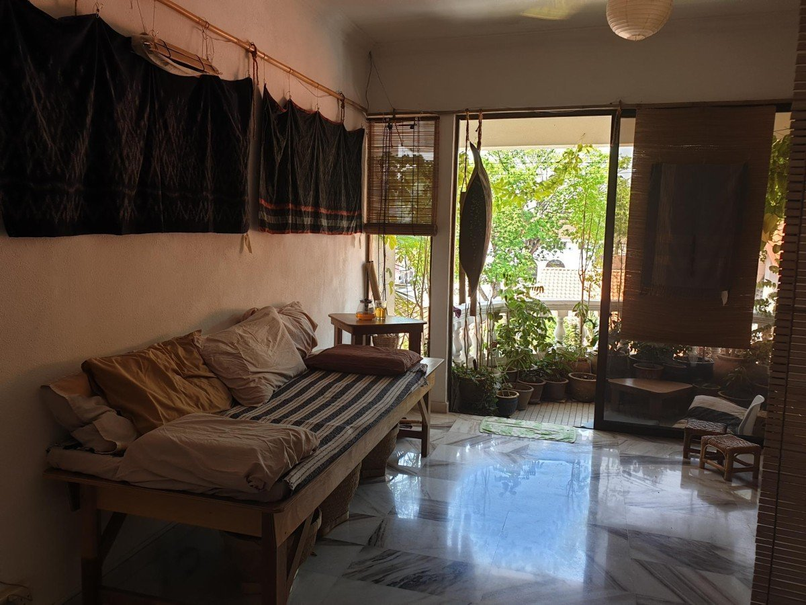
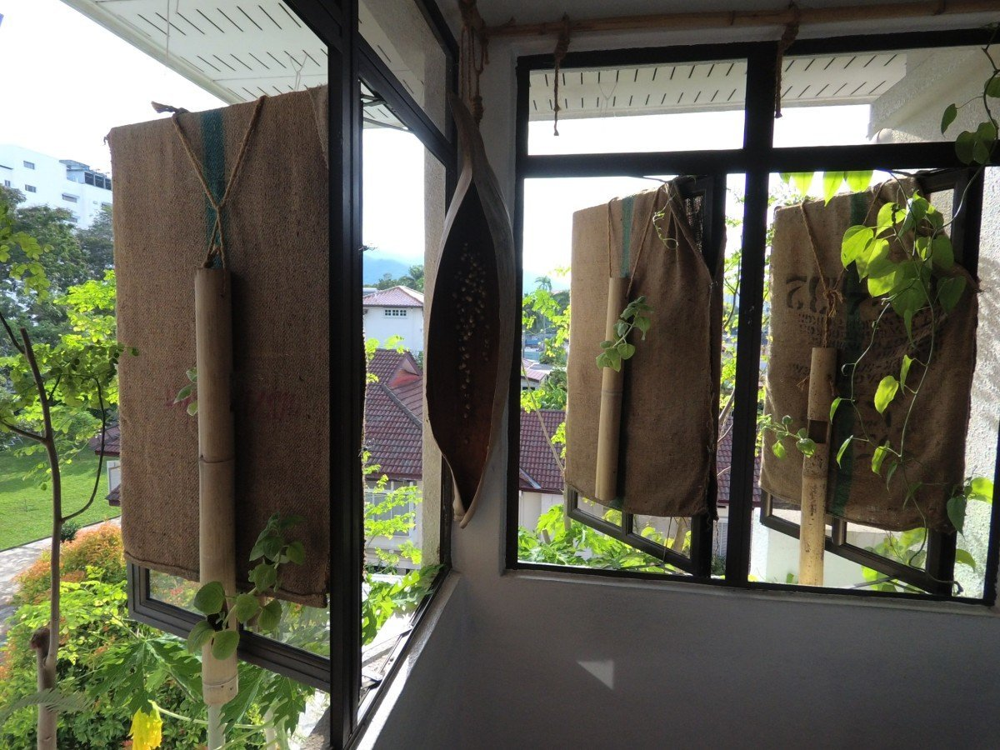
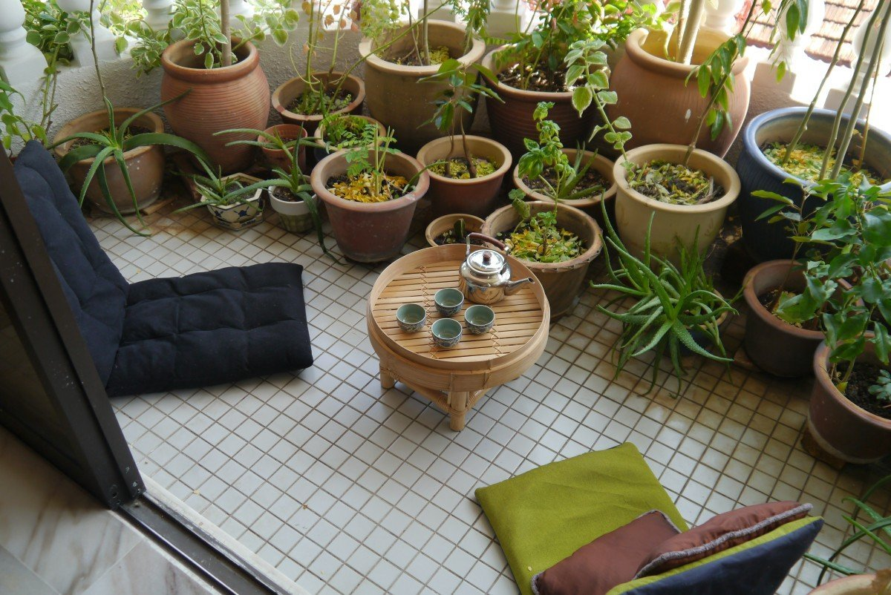

# Urbaculture

*Living with What Is Here*

![Six hand-drawn plates: Culture is Cultivated, showing inherited and cultivated strands woven together; A Room for Living, a plant-filled room with natural fibres, a simple kitchen and open floor; Sun, Shade, and Moving Air, showing a woven screen, cross ventilation and a high vent; Materials in Motion, comparing a conventional grow–eat–flush–treat–discharge loop with a grow–eat–collect–compost–soil loop; Eco Enzyme, fruit peels, sugar and water fermenting over about three months; and The Vivarium, a shaded, vine-covered tropical patio.](/assets/urbaculture/urbaculture-plates-v1.jpg)

*Plates are illustrative. All design is site-specific.*

Culture is inherited, but it is also cultivated.

The word *culture* reaches back to the Latin *colere*: to cultivate, tend, and inhabit. Its meanings have grown to include the customs, beliefs, and identities through which people understand themselves and one another. Yet culture is not a finished possession. It is made, tended, questioned, and changed.

A person may remove every garment and still be clothed in inherited beliefs, fears, prejudices, and expectations, some so familiar they are hardly noticed. What remains when those garments begin to fall away?

Differences can be recognized without making strangers of one another. The freedom to question what is inherited opens room to cultivate something new.

## Cultivating a Habitat

Urbaculture is not about bringing nature back into the home.

Nature never left.

Sunlight warms a floor. Air moves through a window. Water passes through pipes and hands. Plants grow toward the light, while countless living processes continue beyond sight. A home is already participating in the living world.

Wind stirs a vine at the window, and its shadow moves across the wall. A hanging textile gives the air a visible form. After sunset, moonlight or a streetlamp can cast the moving shadows of patio trees into a room.

The arrangement of a room changes how it feels to inhabit: a chair drawn toward the morning sun, a woven screen softening the afternoon heat, a clear stretch of floor inviting movement and dance. There are places to prepare food, work with the hands, rest, gather, and play. Natural fibres, familiar objects, plants, and useful materials become part of the composition.

Christopher Alexander called these recurring relationships between space and daily life a pattern language. A sunny place to sit in the morning is one such pattern. It holds across climates, even as its form changes.

There is an art to creating a habitat that welcomes living rather than merely accommodating it.

## What Is Being Cultivated?

Every flush sets something in motion. Water carries the materials of the body into pipes, tanks, treatment systems, and soil. Nothing disappears simply because it has passed beyond sight. The relationship exists whether or not it receives attention.

For about a year, I explored humanure composting and collected urine separately for fertilizer. An ordinary toilet became something to tend, dusted with dry organic material rather than flushed. There was something almost comical about it.

At the same time, I was making Eco Enzyme from citrus peels and pineapple skins, using the aromatic ferments for household cleaning.

A crack in the property's septic field brought an unexpected observation. The familiar sewage odour gradually gave way to something reminiscent of fermented pineapple and orange peel.

It fascinated me.

A pleasant smell could not establish what was happening within the system or whether the wastewater was safe. But the experience changed the questions I was asking. Could familiar systems be approached differently? What might happen when materials are separated, treated, transformed, or returned through other carefully tended processes?

Taking the septic out of the septic field became an exploration of conditions rather than a rejection of decomposition itself.

A compost vessel, a wastewater field, a fermenting jar, and a garden are all places where materials move and transform. Cultivation is always happening. The question is what conditions are being cultivated, and what grows from them.

## The Living Household

Fruit peels fermenting in a vessel. Kitchen remnants entering a Bokashi system. Milk becoming kefir. A vine shading a window. Rainwater finding its way into a garden.

These are small relationships, yet each invites attention to temperature, moisture, air, materials, and time.

A household has a culture. So does a kitchen, a workshop, a garden, or a neighbourhood.

The Vivarium in George Town, Penang, became one expression of this understanding. Within an existing tropical apartment, with opening windows and a limited budget, plants, shade, fabric screens, and everyday furnishings were brought into relationship. Light shifted. Vines grew. Travellers arrived and departed. The household changed with the people and living things passing through it.

*The Vivarium, George Town, Penang*

It was never a finished composition. The same home approached today might take an entirely different form.

And so could I.

## The Art of Cultivating

A garden cannot stay alive by refusing to grow. Neither can a culture.

What we cultivate does not, by itself, define us. What matters is the relationship entered into through the act of cultivating. There is freedom in this: freedom to reconsider familiar habits, explore other possibilities, and change without disowning everything that came before.

Nothing has to be earned before beginning. A home already belongs to the living world, and so do we. Cultivation is what happens within that belonging.

Urbaculture is more than the cultivation of urban spaces. It is the conscious cultivation of relationships within the living world. Not the pursuit of a perfect life, but the practice of making one.

Care begins with attention to the relationships already present. Daily life gives them expression.
