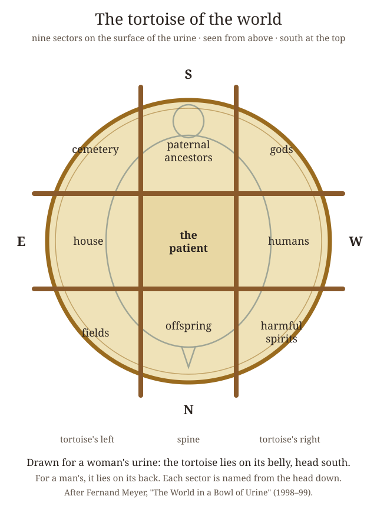
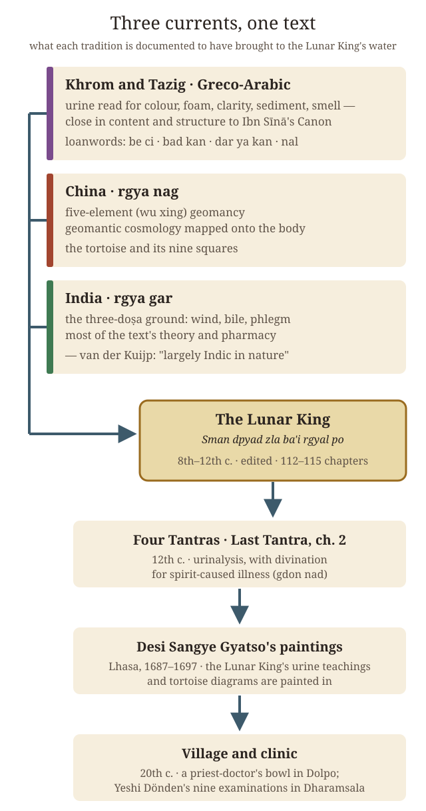
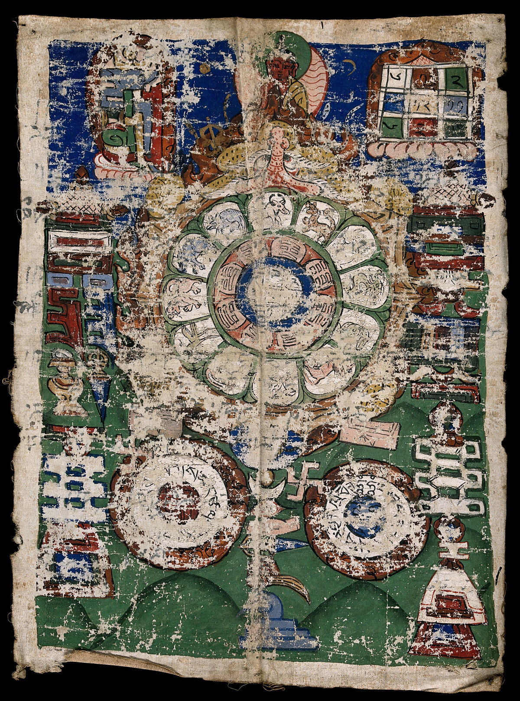
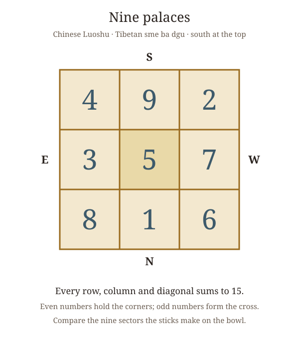

Chapter I · Historical ground

# The Tortoise in the Bowl

Urine divination in Tibet, from the *Lunar King* to a village doorstep

**Reading boundary.** This essay records history and living practice. It describes what Tibetan physicians did and still do with urine; it does not claim that divination diagnoses illness.

**Continues from:** [Golden Lexicon · IV · Reading the Water — The Tibetan System](https://anaseahawk.com/sovereign-biophysics-distillation/00-orientation/golden-lexicon.html#uroscopy)

---

## Contents

01. [A photograph](#photograph)
02. [The nine sectors](#sectors)
03. [Reading the water twice](#twice)
04. [A text called the Lunar King](#text)
05. [Where the water is read](#water)
06. [The western current: Khrom, Tazig, and Ibn Sīnā](#west)
07. [The eastern current: the tortoise of the world](#east)
08. [The unseen current: spirits and the illnesses they cause](#spirits)
09. [Women and the water](#women)
10. [Fading and continuing](#fading)
11. [Two vessels, two maps](#vessels)
12. [Appendix A · The surviving copies of the Lunar King](#appendix-a)
13. [Appendix B · Where the trail goes next](#appendix-b)
14. [Sources & Notes](#sources)

---

## I · A photograph

A man sits on the ground in front of a village house in Dolpo, in the high Tibetan-speaking north of Nepal. His long hair is coiled up in a turban, the mark of a *sngags pa*, a tantric priest. In front of him, directly on the earth, is a plain white porcelain cup of urine, small bubbles floating on its surface. He has just laid two pairs of twigs across the cup so that they cross into a grid. More twigs lie in a heap beside him, and he still holds a bunch of them in his left hand. He leans forward, his face in the shadow of his headdress, and looks straight down into the bowl. [6]

His name was Meme Tenzing of Kagar. The French ethnologist Corneille Jest photographed him during a consultation and published the picture in his 1975 study of Dolpo with a plain caption: diagnosis of an illness by divination with the patient's urine. A second photograph from the same spot shows Meme Tenzing taking the pulse on the left wrist of a village woman, so the urine in the cup was very likely hers. [6]

Fernand Meyer, a physician turned historian who became one of the great scholars of Tibetan medicine, wrote about this photograph two decades later. As far as he knew, it was the first picture ever taken of the technique. He had never once seen it practised himself, and by the time he wrote, it had nearly vanished: Tibetan doctors still examined urine, though less often than the pulse, but had almost entirely abandoned the art of dividing its surface into sectors and reading what appeared there. [6]

He also noticed what the photograph shows about Tibetan medicine as most Tibetans actually met it. Not a monastic college or an institute, but a farmer and ritual specialist, for whom healing was one task among many, working on the ground outside a house. That, Meyer wrote, was the most common situation in traditional Tibet, far from the idealised picture usually shown to Westerners. [6]

Meyer ended his short essay on the moment the photograph catches: the physician, having become a seer, sets aside step-by-step medical reasoning for intuitive perception, his attention sunk into "the iridescent space of the urine bowl which becomes the mirror of the world." [6]

**See the photograph.** Meyer's two-page essay, with Jest's photograph of Meme Tenzing, is free to read in the open archive HAL: [read it here (PDF)](https://halshs.archives-ouvertes.fr/halshs-01694777v1/file/EBHR_15%2616_18.pdf). It takes three minutes, and everything in this essay comes back to that one picture.

First, what he was reading. Then the essay follows the bowl backward, to a text called the *Lunar King*, and outward, to the three medical worlds that met in it.

---

## II · The nine sectors

The twigs on Meme Tenzing's cup were not laid at random. Meyer's essay records the scheme behind them, and it is the clearest account in English. [6]

**The tortoise is laid on the water.** In this reading the bowl is likened to "the tortoise of the world" (*srid pa'i rus sbal*), a layout the Tibetans ascribe to China. (Where that tortoise comes from is the subject of [section VII](#east).) For a man it lies on its back; for a woman, on its belly. Either way its head points south. Men urinate into the bowl from its eastern side, women from its western side.

**The grid.** Two pairs of crossed sticks make nine sectors (*re'u mig*, a grid of cells); their criss-cross is said to recall the grid marking the upper and lower shells of tortoises. The centre is surrounded by eight sectors facing the four directions and the four in between.

**The names.** Each column of three is read from the tortoise's head downward:

| | head end | middle | tail end |
|---|---|---|---|
| **tortoise's right side** | gods | humans | harmful spirits (*gdon sa*) |
| **spine** | paternal ancestors | the patient | the offspring |
| **tortoise's left side** | cemetery (*dur sa*) | house | fields |

The patient sits at the heart of the grid, with forebears above and children below. One side holds the beings who act on a life (gods, people, spirits). The other holds the places where a life is lived and ends (the graveyard, the house, the fields).

**The reading.** The physician looks for figures in the urine (points, circles, cracks) formed by the bubbles, by the surface layer, and by what hangs suspended in the liquid, and notes which sector each appears in. Meyer gives one example: a figure in the sector of the gods means the trouble comes from a protective deity (*lha srung*) connected with the paternal ancestors or with the patient, and the remedy is confession and propitiation. [6]

<figure>
  
  <figcaption><strong>The tortoise of the world.</strong> The nine sectors as recorded by Fernand Meyer, drawn for a woman's urine, with the tortoise lying on its belly so that its right side falls to the viewer's right (west). Drawn by the archive from [6].</figcaption>
</figure>

**A question of sides.** When the tortoise rolls onto its back for a man's urine, simple geometry would swing its right side over to the east. One modern summary, citing Lobsang Rapgay and Tsering Thakchoe Drungtso, places the right side to the west for both sexes. [16] Meyer does not specify. The *Last Tantra*'s urine chapter would settle it.

---

## III · Reading the water twice

In Tibetan the urine is simply *chu*, "water." Pulse and urine together are *rtsa chu*, and urine examination is *chu'i brtag pa*, the examination of the water. [7]

A Tibetan physician could read the same cup in two different ways.

### The first reading: the body

The *Four Tantras*, the twelfth-century foundation text of Tibetan medicine, lists the three ways to know a disease: looking, touching, and asking. Looking means the tongue and the urine. [17] Its signs for the three *nyes pa*, the humors or "faults," are short enough to memorise, and generations of students did:

> Urine in wind disorders looks like water and has large bubbles. In a bile disorder the urine is reddish yellow and malodorous, with much steam. Urine (reflecting a) phlegm disorder is whitish with little odor or steam. [17]

The full method sits in the fourth book, the *Last Tantra*, whose second chapter is devoted to urine. [17] Yeshi Dönden, who served as personal physician to the Dalai Lama for eighteen years and re-founded the Tibetan Medical and Astrological Institute in exile, describes the examination as he practised it [18]:

- while the urine is **hot**: its colour, vapour, odour, and froth;
- once it is **lukewarm**: the cloudiness suspended in it, and the oily skim on its surface;
- once it is **cold**: the gradations of colour, how the colour changed as it cooled, and the final colour.

His images stay in the mind. In a wind disorder the urine is "clear like mountain spring water," with froth bubbles as large as "buffalo eyeballs." In a phlegm disorder the froth is "soft like the froth of saliva." [18]

The *Last Tantra*'s own instructions, in Rechung Rinpoche's translation, set the scene. [20] The evening before, the patient eats mild food, drinks when thirsty, and sleeps well. Urine passed before midnight is not tested, because the day's food is still colouring it; the first urine at dawn is the one to read. It goes into a plain container so that nothing alters its colour, and it is stirred with a white stick or a straw.

Healthy urine, the chapter says, is "white with a yellowish tinge like the colour of freshly-melted butter." [20] From there the signs multiply. A rusty smell points to wind; a smell like burnt flowers or butter, to bile; a stale smell, to phlegm. Bubbles that shimmer with rainbow colours mean poison. And the sediment is read for where it settles: high in the urine for the heart and lungs, halfway for the region between the heart and the navel, low for the kidneys and intestines. [20] The column of urine is a map of the body, top to bottom.

The cup in Jest's photograph follows the *Four Tantras* to the letter: white porcelain, undecorated, so that nothing blurs the examination. [6] The Golden Lexicon sets out the rest of this medical reading, including the stick-beating test.

### The second reading: the unseen

Then there is the other reading, the one Meme Tenzing was doing, with the sectors laid out above. Dönden says the colour patterns of urine run "from top to bottom, and from the middle to the periphery," that explaining them fully would take about twenty days, and that by examining these patterns "one can determine if there are any kinds of demonic influences harming the patient." [18] He says no more about how. Meyer is direct: in this reading the aim is not to name a disease according to medical classification, but to identify the harmful spirit causing the patient's suffering. [6]

Same water, same morning, same physician. Two questions asked of it. Historians call the first **uroscopy**, urine-viewing, and the second **uromancy**, urine divination. The *Four Tantras* holds both: according to Meyer, an important part of its vast urine chapter concerns divination. [6]

### What the water is

Urine is made from blood. The kidneys filter the liquid part of the blood, the plasma, return almost all of it to the body, and release what remains as urine. The fluid in the cup was moving through the veins and the heart a few hours before it reached the bowl. That is why it carries so much of the body's story, and why it can be read without a needle.

The *Four Tantras* teaches otherwise. Its second book says that once food is digested, its wastes divide in the small intestine into solid and fluid; the solids become stool and the fluids become urine. [17] Its fourth book adds a second stream: the nourishing part of food goes to the liver and becomes blood, the blood's residue becomes bile, and the residue of bile passes to the bladder. "Therefore," the *Last Tantra* concludes, the sediment in urine "originates from blood and bile." [20]

So the Tibetan physicians half-saw the link to the blood, but only for the sediment. Their main account, that the urine itself flows from the intestine to the bladder, is wrong. Nothing passes from the gut to the bladder except by way of the blood.

The mistake is an old and widespread one. In Greece, the physician Asclepiades taught that what we drink reaches the bladder as vapour, soaking through it like a sponge. Galen answered him in the second century by tying off the ureters, the tubes between the kidneys and the bladder: the bladder stayed empty, and the urine backed up above the knots. [19] The urine had come from the kidneys, not straight from the gut.

The Tibetan physicians had the source wrong, but they read the water well. Their rule that the evening's food and drink colour the morning's urine holds true, because what we eat and drink passes into the blood before the kidneys release it.

---

## IV · A text called the Lunar King

### The name

The Tibetan title is *Sman dpyad zla ba'i rgyal po*, usually translated *Medical Method of the Lunar King* or *Medicine of the Moon King*. Tibetan writers also call it *Somarāja*, "Moon King." Its eighteenth-century woodblock edition gives it a pseudo-Sanskrit title that does not actually match the Tibetan, and whose word *sādhana*, "ritual practice," fits nothing in a work with no spells or evocations at all. [7] *Somarāja* also happens to be a name for musk mallow (*Abelmoschus moschatus*). [7]

### The story it tells about itself

The woodblock edition opens with Mañjuśrī, bodhisattva of wisdom, teaching medicine on the central peak of a five-peaked mountain, at the request of the master Nāgārjuna. A manuscript of the text in the Potala library names that mountain in a form that Leonard van der Kuijp of Harvard reads as an early Tibetan rendering of Wutaishan, the Five-Terrace Mountain in China long associated with Mañjuśrī. [7] The scene is Chinese; the speakers are Indian Buddhist figures.

The translator's colophon says the work was rendered into Tibetan in the reign of the emperor Trisong Detsen (eighth century) by the Chinese monk Hwashang Mahāyāna and the great Tibetan translator Vairocana, in connection with a Chinese physician whom the colophon names. [7] The Potala manuscript claims two translations, one from Sanskrit and one from Chinese. [7]

Later historians added their own layers. The sixteenth-century historian Pawo Tsuglag Trengwa says the work had 115 chapters and links it with the Chinese princess Jincheng, who came to Tibet as a bride around 710 bringing astrological and medical books. Desi Sangye Gyatso, regent of Tibet in the late seventeenth century, repeats much of this and speaks of a later translation in 112 chapters. [7, 8] The woodblock lists 113. [7]

### When it was written

Nobody knows exactly. Ronit Yoeli-Tlalim, the historian whose work matters most for our subject, places it somewhere between the eighth and twelfth centuries, in a text edited at points no one can now determine. [1] No critical edition exists; the surviving copies are described in [Appendix A](#appendix-a).

### Chinese, Indian, or both?

Tibetan historians argued for centuries over whether the text came from India or from China. [1] The sixteenth-century physician Zurkharwa Lodrö Gyalpo, who edited the *Four Tantras*, rejected the story that Nāgārjuna and Mañjuśrī taught it, judged it a genuine Chinese medical work, and blamed its errors on a poor translation. [7]

Van der Kuijp's answer is that it is both and more: a hybrid in which several medical traditions met, largely Indian in substance and very probably reaching Tibet by way of China. [7] Its pulse theory carries Chinese influence. [7] Its urine chapters carry something that is neither Indian nor Chinese.

Yoeli-Tlalim borrows an image from the historian Matthew Kapstein for how hard early Tibet is to see clearly: a long hall of mirrors, its far end hidden by a translucent curtain woven from the great myths that later centuries told about the empire. [1] The *Lunar King* stands right at that curtain.

---

## V · Where the water is read

### The first urine analysis in Tibet

The *Lunar King* holds the earliest known references to any kind of medical urine analysis in Tibet. [3] The oldest Tibetan medical documents of all, the manuscripts sealed in the Dunhuang cave library in the early eleventh century, deal with moxibustion, materia medica, and general treatment, and say nothing about reading urine. [1]

### Four chapters, or five

The urine material runs through consecutive chapters, and scholars count them differently.

- **Yoeli-Tlalim** describes four, covering urine examined by sight, urine in relation to disease and to harmful spirits, and urine divination. Her study analyses the observational section, folios 53–60 of the Leh reprint of the Derge woodblock, and leaves the divination for another day. [2]
- **Erik Jampa Andersson**, trained in Tibetan medicine at the Shang Shung Institute and in history at Goldsmiths, teaches from "four chapters on uromancy." [3, 12]
- **Tony Chui** of the University of Hong Kong reads five. [4]

They are likely drawing the line between observation and divination in different places.

### Five frameworks for one water

Chui's reading is the best map of the whole section. He finds a different framework in each chapter [4]:

- the physical appearance of the urine;
- the influence of the seasons;
- demons as a cause of disease;
- basic Chinese five-element (*wu xing*) geomancy;
- Chinese geomantic cosmology applied to the human body.

The chapters do not merge into one system. Each can be read and used on its own. Chui sees that as a strength: a flexible, case-by-case toolkit at a formative moment in the tradition. [4]

So the *Lunar King*'s urine section is not one method. It is several methods from several worlds, set side by side on the same shelf.

<figure>
  
  <figcaption><strong>Three currents, one text.</strong> What each tradition is documented to have brought to the <em>Lunar King</em>, and where the practice went after it. Diagram by the archive, from sources [1], [2], [4], [6], [7], [8], [18].</figcaption>
</figure>

---

## VI · The western current: Khrom, Tazig, and Ibn Sīnā

### A feature neither Indian nor Chinese

Yoeli-Tlalim started from a simple observation. Urine analysis as a *general* diagnostic tool is not characteristic of Indian or Chinese medicine, yet it stands at the centre of the *Lunar King*. [1] So she set its urine section beside the urine section of Ibn Sīnā's *Canon of Medicine* (*al-Qānūn fī al-ṭibb*, early eleventh century), the great Persian synthesis of Greek and Arabic medicine, and found them remarkably similar in content and in structure. [1, 5]

The parallels she documents [2]:

| Point of practice | Ibn Sīnā, *Canon* | *Lunar King* |
|---|---|---|
| When to collect | early morning | early morning |
| Where to examine | bright place, out of direct sun | bright place, out of direct sun |
| Night before | no sexual activity | no sexual activity |
| Diet | avoid what colours the urine | avoid what colours the urine |
| Vessel | clear white glass urinal | a colourless container |
| What is read | quantity, odour, colour, foam, texture, clarity, sediment | all of these except quantity |
| Colour | many shades of yellow, red, green, black, white; compounds; a "bright" class | a similarly detailed scheme |
| Bubbles | colour, size, number, how fast they burst | colour and size |
| Sediment | separation, shape, amount, colour, where it settles | the same, plus cloudiness |

There are differences too. Ibn Sīnā asks the patient to avoid exhaustion, fasting, sleeplessness, and anger; the *Lunar King* does not. The *Lunar King* includes a section on the qualities required of the examining doctor that the *Canon* lacks. [2] Yoeli-Tlalim's conclusion is that the two texts share a common tradition rather than one copying the other, and that Ibn Sīnā's account is the fuller. [2]

### Words that travelled

The vocabulary points the same way. Yoeli-Tlalim identifies words in the *Lunar King* that appear to have come from Arabic or Persian [2]:

- ***be ci***, "physician," in the text's own colophon, traced to Persian; others have proposed a Sogdian route.
- ***bad kan***, "phlegm," one of the three humors themselves, connected to an Arabic term for phlegm.
- ***dar ya kan***, a cure-all potion, which Christopher Beckwith traced to *theriac*, the ancient Greek antidote that became Arabic *tiryāq*. The *Lunar King* gives it a whole chapter and calls it an elixir. [2, 7, 8] Van der Kuijp complicates the picture: in one Dunhuang manuscript the word is glossed with the Chinese name of a peppergrass, and Tibetan materia medica treat *dar ya kan* as a plant. [7]
- ***nal***, "ruby," used in the text to name a reddish-brown urine colour, from Persian *lāl*.

Each derivation is argued rather than settled, and van der Kuijp, who checks such claims closely, faults Yoeli-Tlalim on a different word, the Tibetan for camphor. [7] Taken together, though, the cluster tells a story. Look at the last one again: a Persian gemstone naming the colour of urine in a bowl in Tibet.

### Two verses that disagree

Tibetan tradition both remembered this current and forgot it.

The *Four Tantras*, near the end of its last book, maps where each medical art was taught: compounding medicine in India, moxibustion and channel-cleansing in China, bloodletting in Dolpo, and pulse reading and urine examination *in Tibet*. [7]

The thirteenth-century physician Gtsang stod pa Dar ma mgon po, in a short treatise on heat therapy, draws the map differently: medicine-making from India, phlebotomy from Nepal, pulse from China, heat therapy from the Turko-Uyghur lands, and urine examination from **Khrom**. [7]

Khrom (or Phrom) is the Tibetan name for a western land, often understood as Rome or Byzantium, sometimes set beside Tazig, the Persian and Arab world. [1, 7, 8] The biography of the Elder Yuthok, as Rechung Rinpoche translates it, gives the same answer as Gtsang stod pa: asked by foreign physicians where each art excelled, Yuthok says the Chinese excelled in prognosis by astrology, and "Khrom in the examination of the urine." [20] Later histories also gave Khrom a famous physician of its own.

### Galenos in Lhasa

Sixteenth- and seventeenth-century Tibetan histories tell of three foreign physicians invited to the Tibetan court, one from India, one from China, and one from Khrom named **Galenos**, who stayed on as royal physician, settled in Lhasa, married, and founded a medical family. [1, 8]

Yoeli-Tlalim's reading of this story is a model of how to hold a legend. Galenic medicine really did leave traces in early Tibet, and diagnosis by urine is the clearest of them. But the earliest Tibetan medical history we have, from the early thirteenth century, lists foreign medical schools including Arabo-Persian and Byzantine ones and names no Galenos at all. The starring role was very probably written back into imperial times by later historians, for reasons of their own century. [1]

The western current is real. The man said to have carried it is a later portrait.

---

## VII · The eastern current: the tortoise of the world

### Chinese cosmology in the urine chapters

Two of the frameworks Chui finds in the urine chapters are Chinese: five-element geomancy, and Chinese geomantic cosmology mapped onto the body. [4] Meyer says the same of the divinatory layout itself: Tibetans ascribe it to China. [6] Gavin Kilty, translator of Desi Sangye Gyatso's history of Tibetan medicine, calls the urine divination with a turtle grid distinctly Chinese. [8]

### The tortoise on the wall

In Tibetan astrology, the branch that came from China (*nag rtsis*) works with five elements, twelve animal signs, eight trigrams, and nine numbered squares. [10] Its central image is a tortoise.

Protective charts, still hung in Tibetan homes and engraved on amulets, show a tortoise lying on its back. On its belly sit concentric rings: at the centre the nine magic numbers (*sme ba dgu*), around them the eight trigrams (*spar kha*), and around those the twelve animals of the calendar. [11]

<figure>
  
  <figcaption><strong>The tortoise on an amulet.</strong> Tibetan cosmological amulet for protection against diseases, gouache on cloth, 29 × 21 cm. Wellcome's catalogue describes a tortoise at its centre carrying the nine-square <em>sme ba dgu</em>, ringed by the eight trigrams and the twelve animals of the calendar; the middle has worn away, but the twelve animals still circle it, and a second nine-square grid sits clear on a lotus at upper right. [22] Wellcome Collection, ref. 581586i. Public Domain Mark.</figcaption>
</figure>

<figure>
  
  <figcaption><strong>The tortoise in the clinic.</strong> Bloodletting chart, Tibet, Wellcome Collection Or Tibetan 114. It tells the physician which days are favourable or unfavourable for bloodletting, and when to guard against demons. At its centre the cosmic tortoise lies head upward, carrying the twelve animals, the eight trigrams, and the nine-square <em>sme ba</em>; the days of the week trail below its tail, and its border holds the 106 compartments that mark the bloodletting days. Above sit Mañjuśrī with his sword, White Tārā and Vajrapāṇi. The four creatures around it, dragon, bird, tiger and tortoise, are the animals of the four directions in Chinese cosmology. [23] CC BY 4.0, Wellcome Collection.</figcaption>
</figure>

The French Tibetologist Philippe Cornu records the myth behind it. At the beginning of this age, when the universe was still chaos, Mañjuśrī caused a giant golden turtle to rise from his own mind out of the primordial ocean. Seeing that the coming world needed a stable base, he pierced the turtle's flank with a golden arrow. It rolled onto its back and sank, "giving forth blood and excrement," and from these the elements of the universe arose. The world came to rest on its flat belly, where Mañjuśrī wrote all the secrets of the times to come. [21]

The turtle's body became a map of the elements. Citing a Tibetan astrological text, Cornu sets them out: Wood, in the east, is a tree with soft green leaves, linked to the sword of Mañjuśrī piercing the turtle; Fire, in the south, is "the visceral blood of the cosmic turtle"; Metal, in the west, is the point of Mañjuśrī's sword emerging from its left flank; its four limbs, at the four intermediate directions, are Earth; and its tail points north, to Water, which is "symbolized by waves or by the urine of the cosmic turtle." Water's organ is the kidney, "the regulator of bodily fluids," and its flavour is salt. [21]

The nine magic numbers are the Tibetan form of the Chinese **Luoshu**, the nine-palace square. In Chinese legend it rose from the Luo River on the shell of a tortoise in the time of the flood-taming ruler Yu. Its numbers are arranged so that every row, column, and diagonal adds to fifteen, and in its traditional orientation south is at the top. [13]

<figure>
  
  <figcaption><strong>Nine palaces.</strong> The Luoshu square as it sits at the heart of Tibetan astrological charts (<em>sme ba dgu</em>), south at the top. Diagram by the archive, from [13].</figcaption>
</figure>

### The tortoise in the bowl

Now go back to the bowl in [section II](#sectors), likened to the tortoise of the world and divided into nine. [6]

So a cup of morning urine on the ground in Dolpo is treated as the same cosmic tortoise that carries the nine squares on Tibetan charts. The sources do not say in so many words that the bowl's nine sectors *are* the Luoshu. But the tortoise, the nine-fold grid, the southward head, the Chinese ascription, and Chui's "geomantic cosmology applied to the body" all point the same way. The bowl becomes a small cosmos, and the patient's water takes the place of the sky.

There is one more correspondence, and it is ours rather than the sources'. In the bowl, the tortoise's head always points south and its tail north. On the cosmic turtle, south is Fire, its blood, and north, at the tail, is Water, its urine. A cup of human urine is laid over a turtle whose own urine is the waters of the world.

The tortoise even appears inside the body. The *Four Tantras* names each week of the life in the womb, and in the seventeenth week, when the limbs and the countless inner channels have formed, "the body looks like a tortoise. Therefore this is called the tortoise period." [20]

---

## VIII · The unseen current: spirits and the illnesses they cause

### Illness with an author

Tibetan medicine classifies disease into 404 kinds. One set of 101 is made up of minor complaints that heal by themselves; another of illnesses curable with treatment; another of illnesses rooted in past karma; and one set of 101 of illnesses inflicted by spirits, which medicine alone will not cure. [8, 18]

Dönden names some of the agents: planetary influences, gods, *yakṣas*, the 1,080 kinds of elemental *bhūtas*, *nāgas* (serpent beings of rivers and lakes), *rgyal po* spirits, and earth spirits (*sa bdag*). In the tradition, he notes, *nāgas* and earth spirits are often involved in the formation of tumours, and in old Tibet the first response was offerings and rituals to pacify them. [18]

For these illnesses the question is not only *what is wrong* but *who is acting*. That is the question the second reading of the bowl answers. According to the *Four Tantras*, urine divination is principally a method for detecting spirit-caused illness (*gdon nad*). [3] Demons as a cause of disease are already one of the frameworks in the *Lunar King*'s urine chapters. [4]

### The line of descent

- **The *Four Tantras* (twelfth century).** The urine chapter of its *Last Tantra* includes divination techniques; Meyer notes that some of them involve more sectors and more elaborate calculations, taking in the directions of space, astrology, and geomancy. [6, 17] A modern painting set made in Chentsa, Amdo, illustrating that chapter has plates on urinalysis whose subject is "Demonic Possession — Divination." [9]
- **Desi Sangye Gyatso's paintings (Lhasa, 1687–1697).** The regent's great set of medical paintings drew on the *Lunar King* directly. [8, 14] Among the items he describes as taken from it are three tortoise diagrams for men and women, in the section on urine signs of spirit possession, and depictions of the harm done by nine types of spirit. [8] The *Lunar King*'s chapter titles, in his catalogue as Kilty translates it, include urine divination for spirits and illness, urine divination according to the seasons, and a teaching addressed to Aśvinī on the nine diagrams. [8] Aśvinī recalls the Aśvins, the twin physician gods of the Vedas: an Indian name presiding over a Chinese grid in a Tibetan book.
- **Lineages.** Desi Sangye Gyatso records physicians receiving collections of goddess practices for urine divination as part of their transmissions. [8]

---

## IX · Women and the water

The bowl distinguishes a woman's water from a man's from the very first moment: the side she approaches it from, and how the tortoise lies within it. [6]

The patient in Jest's photograph was very probably a woman, the same villager whose pulse Meme Tenzing took a moment earlier. [6] If so, the tortoise in that cup was lying on its belly.

The practice itself traces part of its lineage to a woman. Jampa Andersson's teaching notes a special uromancy system that Yuthok Yönten Gönpo, the great physician associated with the *Four Tantras*, is said to have received from the ḍākinī Karmamahendrāṇī (*Mkha' 'gro Las kyi dBang mo*). [3] And the transmissions recorded by Desi Sangye Gyatso include collections of goddess practices for urine divination. [8]

In the twentieth century, women carried the physician's art too. Khyenrap Norbu, director of Lhasa's medical colleges and physician to the Thirteenth and Fourteenth Dalai Lamas, encouraged women to study medicine; the celebrated physician Yangchen Lhamo is the example usually given. [8, 18] Yeshi Dönden studied for five years under the same master. [18] In exile in Dharamsala, Dr. Lobsang Dolma Khangkar, known as Ama Lobsang, became a much-loved physician to refugees and visitors alike. [8]

The written record of this tradition is overwhelmingly male: male authors, male lineage holders, male physicians in the photographs. It records who could write and who held institutions, and in Tibet those were the monasteries and the medical lineages, which passed the art mostly from man to man. What women knew and taught by word of mouth left little trace in it.

Elsewhere, some of the oldest written urine practices belong to women's bodies. In an Egyptian medical papyrus now in Berlin, written down more than three thousand years ago, a woman urinated on wheat and barley. If the grain sprouted, she was pregnant; which grain sprouted first was said to tell the sex of the child to come. The test turns up again in later Egyptian papyri, and in European folk practice centuries afterwards. [24, 25] Whether it worked is still argued over. A small trial in Cairo in 1963 found that pregnant women's urine sometimes encouraged the grain and sometimes did not, and that the sex prediction failed. [25] But the belief underneath it was right. A woman's urine does carry the news of a pregnancy: the first laboratory pregnancy tests, in the 1920s, were made with women's urine, and every pregnancy test sold today is a urine test, detecting the hormone hCG. The grain may not have been a reliable instrument, but the water held the signal all along. A woman reading her own water for news of a life inside her: that is among the first readings of urine anyone wrote down.

This thread deserves its own research: who taught women to read the water, and whether women practitioners in village Tibet read it too. The archive's [Women of Alchemy](https://anaseahawk.com/sovereign-biophysics-distillation/00-orientation/women-of-alchemy.html) follows the same question through the Western tradition.

---

## X · Fading and continuing

By the late twentieth century, Meyer wrote, the divinatory reading of urine had practically died out among Tibetan doctors. Few publications even mention it. [6] Jest's photograph may show one of its last everyday uses.

But the wider practice did not die. Tibetan physicians still read the morning urine for colour, steam, froth, and sediment, as Dönden describes. [18] And the logic of the second reading lives on in another form. In Dharamsala, Dönden writes, a doctor who lacks enough information may encourage the patient to ask a lama for a divination; if the illness is judged to come from an unseen influence, the lama may send the patient not to a doctor at all, but to a tantric adept. [18]

Dönden also describes what a lifetime of reading pulse and urine can do to the reader. A physician who becomes a true expert in these, he says, may find that "one's intuition and senses can become so refined that it is as if one had extrasensory perception." [18] Meyer, looking at Meme Tenzing, saw the same thing: the doctor become a seer, the bowl become a mirror. [6]

---

## XI · Two vessels, two maps

The Golden Lexicon shows the medieval European **matula** as a body map. The flask was held up to the light and read from top to bottom: the ring at the surface for the head, the upper layer for the chest, the body of the urine for the belly, the sediment for the kidneys and genitals. The body stood inside the glass.

The Tibetan medical reading, as we saw, does the same: the *Last Tantra* reads the sediment by height, from the heart and lungs at the top to the kidneys and intestines below. [20] Two traditions, far apart, both stood the body upright inside the urine.

The divinatory reading turns the same bowl ninety degrees. It sits on the ground and is looked down into. Its surface is laid out flat like a map of the land, south at the top as on every Tibetan and Chinese chart. Its sectors are directions, kin, and places.

| | European matula, and the Tibetan medical reading | Tibetan divinatory bowl |
|---|---|---|
| How it is read | in depth, top to bottom | flat, viewed from above |
| How it is divided | horizontal layers | nine sectors by crossed sticks |
| What it maps | the body, head to lower organs | the patient's world: gods, ancestors, house, fields |
| What it finds | imbalance within | influences acting from outside |
| Its image | a body standing in the water | the tortoise of the world |

Read from the side, the urine holds the body. Read from above, it holds the world. A Tibetan physician could do both with the same cup. That is why Meyer called his essay "The World in a Bowl of Urine."

Yoeli-Tlalim adds one more turn. In Tibetan medicine, she argues, diagnosis and prognosis overlap: the reading that tells you what is wrong also tells you what is coming, which is exactly where medicine meets astrology. [5] The urine in the cup is a record of the night just past, read at dawn for what lies ahead.

---

## Appendix A · The surviving copies of the Lunar King

Yoeli-Tlalim names the central problem in dating the *Lunar King*: the text has been edited, and neither the extent nor the timing of that editing can be determined. [1] Van der Kuijp places it in the second half of the eighth century while stressing its very complicated biography. [7]

The surviving copies explain the uncertainty. [7]

- **The Derge woodblock (c. 1772–73).** Every modern printed edition descends from it. The scholar-physician Situ Paṇchen Chökyi Jungné looked over the edition in late 1772, and it appears to be the first time the text was ever carved for printing.
- **A Beijing manuscript** of 112 chapters, studied by the Tibetan scholar Rinchen Gyal, who dates its handwriting to the tenth or eleventh century. It has more glosses than the woodblock and is not a copy of it.
- **A Potala manuscript** of 287 folios, annotated in red and black ink, which differs from the woodblock on page after page.

No critical edition exists. Not one chapter has yet been edited critically. [7]

---

## Appendix B · Where the trail goes next

This essay rests on what can be read in English today. These are the next layers.

- **The *Last Tantra*'s urine chapter.** The canonical description of the divination, including the elaborate schemes with more sectors, is in the second chapter of the fourth book of the *Four Tantras*. Rechung Rinpoche's 1973 translation of that chapter is abridged to its medical signs and leaves the divination out. [20] The full chapter is published in English by Men-Tsee-Khang as the *Subsequent Tantra*, and it would settle the open question of sides.
- **The *Lunar King*'s divination chapters.** Untranslated in any Western language, and the text has no critical edition. [7] The Tibetan scholar Rinchen Gyal has published on the text and on its relation to Persian medicine, in Tibetan. [7]
- **The paintings.** Meyer points to the published volume of Desi Sangye Gyatso's paintings (Parfionovich, Dorje and Meyer, 1992), pp. 143–148, for the full iconography of the divination plates. [6]
- **The photograph.** Corneille Jest's image of Meme Tenzing (first published in his 1975 study of Dolpo, reproduced in [6]) is the visual heart of this story, and worth seeking permission to show.
- **Bön.** Whether the tortoise of the world has its own history in Bön, Tibet's other religious tradition, is unexplored here.
- **Urine as medicine in Tibet.** The Buddha's monastic code allowed fermented urine as a medicine (see the Golden Lexicon). Whether Tibet's monasteries and physicians kept that medicine is an open question.

---

## · Sources & Notes

01. [Ronit Yoeli-Tlalim, "Re-visiting 'Galen in Tibet'," *Medical History* 56.3 (2012)](https://www.cambridge.org/core/journals/medical-history/article/revisiting-galen-in-tibet1/4ECE5969EF74F5766FC2861BCC07BC38) — dating, the Ibn Sīnā comparison in summary, the Dunhuang medical manuscripts, the Galenos legend, Kapstein's hall of mirrors. Open access.
02. [Ronit Yoeli-Tlalim, "On urine analysis and Tibetan medicine's connections with the West," in S. Craig et al. (eds.), *Studies of Medical Pluralism in Tibetan History and Society* (2010), 195–211](https://research.gold.ac.uk/id/eprint/3757/) — the detailed comparison with the *Canon*, the loanwords, folio references. [Academia.edu copy](https://www.academia.edu/668400/On_urine_analysis_and_Tibetan_medicines_connections_with_the_West).
03. [Shrīmālā, "Consulting the Golden Mirror: Urine Divination and Medical Innovation in the Tibetan Tradition," workshop by Erik Jampa Andersson](https://www.shrimala.com/events-and-workshops/the-golden-mirror-the-history-and-practice-of-uromancy-in-tibetan-medicine) — earliest Tibetan urine analysis, four uromancy chapters, *gdon nad*, Yuthok and Karmamahendrāṇī. A course description.
04. [Tony Chui, "Fluid Urinalysis: Five Chapters From the Medicine of the Moon King," European Conference of South Asian Studies (2021), abstract](https://ecsas2021.univie.ac.at/papers/ajgwg/) — the five frameworks. Also at the [University of Hong Kong repository](https://hub.hku.hk/handle/10722/302003).
05. [Ronit Yoeli-Tlalim, "Tibetan Medical Astrology," in A. Akasoy, C. Burnett and R. Yoeli-Tlalim (eds.), *Astro-Medicine* (2008), 223–236](https://research.gold.ac.uk/id/eprint/3777) — urine-linked divination and its foreign links; the overlap of diagnosis and prognosis. Abstract consulted.
06. [Fernand Meyer, "The World in a Bowl of Urine," *European Bulletin of Himalayan Research* 15–16 (1998–99), 34–35](https://shs.hal.science/halshs-01694777v1) ([PDF](https://halshs.archives-ouvertes.fr/halshs-01694777v1/file/EBHR_15%2616_18.pdf)) — Corneille Jest's photograph of Meme Tenzing of Kagar; the tortoise of the world; orientation for men and women; the nine sectors and their names; figures and remedy; the decline of the practice. Open access. Also in the [issue at Digital Himalaya](https://digitalhimalaya.com/collections/journals/ebhr/index.php?selection=15).
07. [Leonard W. J. van der Kuijp, "Za hor and its Contribution to Tibetan Medicine, Part Two: Sources of the Tibetan Medical Tradition," *Journal of Tibetology* 12 (2016), 63–103](http://www.zangx.com/uploads/ueditor/file/20220530/1653895529.pdf) — the text's witnesses, colophons, chapter counts, Zurkharwa's verdict, the two verses on medical origins, Rinchen Gyal's research.
08. Desi Sangyé Gyatso, *Mirror of Beryl: A Historical Introduction to Tibetan Medicine*, trans. Gavin Kilty (Boston: Wisdom Publications, 2010), Library of Tibetan Classics vol. 28 — translator's introduction (Galenos and Khrom, the *Somarāja* in the paintings, the turtle grid as Chinese, the 404 diseases, Khyenrap Norbu and women physicians, Ama Lobsang); the Desi's catalogue of the *Somarāja*'s chapters and of the paintings.
09. [Rubin Museum, Project Himalayan Art, "Desi Sanggye Gyatso's Medical Paintings"](https://rubinmuseum.org/projecthimalayanart/essays/desi-sanggye-gyatsos-medical-paintings/) and [Chentsa (Amdo) medical painting set, 1995–96](https://rubinmuseum.org/origin/chentsa-amdo-region-northeastern-tibet-jianzha-qinghai-province-china/) — dates of the painting set; the urinalysis and divination plates.
10. [Rubin Museum, Project Himalayan Art, "Medical & Astrological Sciences"](https://rubinmuseum.org/projecthimalayanart/themes/medical-astrological-sciences/) — Chinese elemental divination in Tibet.
11. [Rubin Museum, *Protective Astrological Chart*, Tibet, late 18th–early 19th c. (C2006.71.11)](https://rubinmuseum.org/collection/c2006-71-11/) and [Huntington Archive, "Prognosticator's Diagrams"](https://huntingtonarchive.org/Exhibitions/sama/Essays/KM91.001.006ProgDiag.html) — the tortoise, *sme ba dgu*, *spar kha*; the Mañjuśrī tortoise myth after Philippe Cornu.
12. [Retreat Guru, teacher profile of Erik Jampa Andersson](https://retreat.guru/teachers/157-12223/erik-jampa-andersson) — training and background.
13. [Wikipedia, "Luoshu Square"](https://en.wikipedia.org/wiki/Luoshu_Square) — arrangement, orientation, the tortoise of the Luo River.
14. [Rubin Museum, "Urine Analysis, Painting 64 of the Tibetan Medical Paintings, Ulan Ude Set"](https://rubinmuseum.org/projecthimalayanart/related/urine-analysis-painting-64-of-the-tibetan-medical-paintings-ulan-ude-set/) — early 20th-century copy of the 1687–1697 original.
15. [Lobsang Rapgay, "A Guide to Tibetan Medical Urinalysis," *Tibet Journal* (1986)](https://pubmed.ncbi.nlm.nih.gov/2872777/) — preparation and the nine characteristics (as in the Golden Lexicon).
16. ["Sowa-Rigpa way of Urine analysis (Mootra)," ResearchGate (2023)](https://www.researchgate.net/publication/373236784_Sowa-Rigpa_way_of_Urine_analysis_Mootra) — tortoise orientation for men and women, citing Rapgay (1985) and T. T. Drungtso, *Basic Concept of Tibetan Medicine* (2007). Seen in excerpt.
17. *The Quintessence Tantras of Tibetan Medicine*, trans. Barry Clark (Ithaca: Snow Lion, 1995) — the Root and Explanatory Tantras of the *Four Tantras*: the three methods of diagnosis, the humor signs of urine, urine as the fluid waste of digestion; the introduction on the *Last Tantra*'s pulse and urine chapters.
18. Yeshi Dhonden, *Healing from the Source: The Science and Lore of Tibetan Medicine*, trans. and ed. B. Alan Wallace (Ithaca: Snow Lion, 2000) — the nine features of urine examination and the reading of demonic influence (pp. 90–93); the 404 diseases and the classes of spirits (pp. 78–79, 95–96); divination and the physician's perception today (pp. 175–176); the author's career.
19. [Galen, *On the Natural Faculties* I.13, trans. A. J. Brock (1916)](https://www.intratext.com/IXT/ENG1216/36.HTM) — Asclepiades' theory of urine reaching the bladder as vapour; the ligature of the ureters.
20. Rechung Rinpoche Jampal Kunzang, *Tibetan Medicine Illustrated in Original Texts* (London: Wellcome Institute; Berkeley: University of California Press, 1973) — the *Last Tantra*'s urine chapter, abridged (pp. 96–97): preparation, healthy urine, smells, bubbles, the height of the sediment, the origin of sediment from blood and bile; the "tortoise period" of the embryo (Explanatory Tantra, ch. 2); the Biography of the Elder Yuthok on Khrom and the urine (pp. 202–203).
21. Philippe Cornu, *Tibetan Astrology*, trans. Hamish Gregor (Boston: Shambhala, 1997) — the myth of Mañjuśrī and the golden turtle; the five elements on the turtle's body, including Water as its urine; the orientation of the nine squares.
22. [Wellcome Collection, "Tibetan cosmological amulet for protection against diseases. Gouache painting, Tibet" (ref. 581586i)](https://wellcomecollection.org/works/spbbawjf) — catalogued as no. 52 in Marianne Winder, *Catalogue of Tibetan Manuscripts and Xylographs, and Catalogue of Thankas, Banners and Other Paintings and Drawings in the Library of the Wellcome Institute* (London, 1989). Public Domain Mark.
23. [Wellcome Collection, "Or Tibetan 114 - Bloodletting chart, Tibet"](https://wellcomecollection.org/works/q62v6uth) — the chart's use for bloodletting days and for guarding against demons; the *sme ba*, trigrams, twelve animals, weekday symbols and 106 compartments; Mañjuśrī, White Tārā and Vajrapāṇi. Licensed CC BY 4.0.
24. ["Egyptian Papyrus Reveals Old Wives' Tale Very, Very Old Indeed," *Smithsonian Magazine* (2018)](https://www.smithsonianmag.com/smart-news/egyptian-papyrus-reveals-old-wives-tale-very-very-old-indeed-180970066/) — the wheat-and-barley test in the Berlin papyrus and its later copy in the Carlsberg papyri (Copenhagen); its survival into European folk practice.
25. [P. Ghalioungui, Sh. Khalil and A. R. Ammar, "On an Ancient Egyptian Method of Diagnosing Pregnancy and Determining Foetal Sex," *Medical History* 7.3 (1963), 241–246](https://www.cambridge.org/core/journals/medical-history/article/on-an-ancient-egyptian-method-of-diagnosing-pregnancy-and-determining-foetal-sex/14D30302A038355CB787358800D17D44) — the modern trial. Its control group was very small (two men, six non-pregnant women), and later accounts of its results disagree, so this essay gives no success rate.

**Further reading:** Corneille Jest, *Dolpo. Communautés de langue tibétaine du Népal* (Paris: CNRS, 1975); Yuri Parfionovich, Gyurme Dorje and Fernand Meyer (eds.), *Tibetan Medical Paintings: Illustrations to the Blue Beryl Treatise of Sangye Gyamtso (1653–1705)* (London: Serindia, 1992), pp. 143–148; Fernand Meyer, *Gso-ba rig-pa. Le système médical tibétain* (Paris: CNRS, 1981; repr. 1987); Rinchen Gyal, *Sman dpyad zla ba'i rgyal po'i gzhung don la dpyad pa* (Xining, 2011); Tsering Thakchoe Drungtso, *Tibetan Medicine: The Healing Science of Tibet* (2004); Ronit Yoeli-Tlalim, "A Tibetan Image of Divination: Some Contextual Remarks" (Brill).

**Figures.** The three diagrams were drawn for this archive from the sources in their captions and reproduce no artwork. The amulet is reproduced from the Wellcome Collection under the Public Domain Mark; the bloodletting chart, Or Tibetan 114, under CC BY 4.0, Wellcome Collection.

Research compiled 25 October – 1 November 2026
Sovereign Biophysics · Historical ground

[← Golden Lexicon · Reading the Water](https://anaseahawk.com/sovereign-biophysics-distillation/00-orientation/golden-lexicon.html#uroscopy) · [Sovereign Biophysics Index](https://anaseahawk.com/sovereign-biophysics-distillation/)
